  

  

  
  
  
  

## 关于我 (About Me)

我是一名对技术充满热情的软件开发者，我对后端系统架构、云原生技术以及新兴的鸿蒙生态有浓厚的兴趣，并致力于构建高效、稳定且可扩展的软件系统。

  

## 技术栈 (Tech Stack)

<table>
<tr>
<td width="50%" valign="top">

**后端开发 (Backend)**
- **语言:** `Golang`, `Java`, `Python`, `C`
- **框架:** `Gin`, `Echo`, `gRPC`, `Spring Boot`, `Spring Cloud Alibaba`
- **数据库:** `MySQL`, `PostgreSQL`, `MongoDB`, `Redis`
- **中间件:** `Kafka`, `RabbitMQ`, `RocketMQ`
- **架构:** 精通微服务架构设计与实现，熟悉高并发、分布式系统的开发与优化。

</td>
<td width="50%" valign="top">

**前端开发 (Frontend)**
- **语言/框架:** `React`, `TypeScript`, `Vue.js`
- **UI库:** `Ant Design Pro`

**鸿蒙 & 移动开发 (HarmonyOS & Mobile)**
- **语言:** `ArkTS`, `Cangjie`
- **UI框架:** `ArkUI`
- **架构模式:** `MVVM`, `Stage模型`
- **认证:** HarmonyOS 开发者高级认证

</td>
</tr>
</table>

## 主要项目 & 经历 (Projects & Experience)

| 项目 | 技术栈 | 简介 |
| --- | --- | --- |
| **高并发订单处理系统 (Golang)** | `Gin` + `Kafka` + `Redis` + `Kubernetes` | 实现百万级请求处理能力，并通过 `Kubernetes` 实现服务高可用部署。 |
| **分布式文件存储平台 (Golang)** | `gRPC` + `MinIO` + `Etcd` | 支持大文件分片传输与服务动态发现。 |
| **NTFGeek - 数字藏品交易平台 (Java)** | `Spring Cloud Alibaba` + `Elasticsearch` + `RocketMQ` + `Seata` | 打造高性能、高可用的区块链数字藏品交易平台。 |
| **云界拾光 - 线上图书馆 (Java + React)** | `Spring Boot` + `React` + `Elasticsearch` | 全栈开发模式，实现毫秒级响应的图书检索功能。 |
| **猿码笔记 & 即刻时光 APP (HarmonyOS)** | `ArkTS` + `ArkUI` | 深入实践鸿蒙分布式能力与 `MVVM` 架构，构建流畅且功能丰富的原生应用。 |

## 数据统计 (GitHub Stats)

## 贡献贪吃蛇 (Contribution Snake)

  

  

## 如何联系我 (Get in Touch)

  

**期待与各位技术同仁交流与合作！**

